# Smart Community Service & Complaint Management System

A mobile app for reporting and tracking problems in a college, apartment complex or any shared community: water leaks, broken lights, garbage, security issues and so on. Residents report a problem with photos, the admin assigns it to a staff member, staff update the work, and everybody involved gets notified along the way.


**Stack**

| Part | What I used |
| --- | --- |
| App | React Native (Expo), React Navigation |
| API | Node.js + Express.js, REST |
| Database | MongoDB via Mongoose |
| Auth | JWT, passwords hashed with bcrypt |
| Photos | multer, stored on the server's disk |
| Notifications | in-app list + local device notifications |

## What you need first

- Node.js 18 or newer (I used 22)
- MongoDB running on `localhost:27017`. Either install it, or use the Docker file that comes with the project
- For the app: a phone with the **Expo Go** app, or an Android/iOS emulator, or just a browser (see "Running the app")

## Quick start

Run these from the project folder (the one this README is in).

```bash
# 1. install everything
npm run setup

# 2. start MongoDB (skip if you already have it running)
npm run db

# 3. start the API (leave this terminal open)
npm run api

# 4. in a second terminal, start the app
npm run app
```

The API is now on `http://localhost:5000`. Expo prints a QR code in the second terminal. Scan it with Expo Go (Android) or the Camera app (iOS), and your phone and computer must be on the same wifi.


## How it works

There are three roles.

**Resident (user)** can register, log in, report a complaint with up to 3 photos, see a ticket ID (like `CMP-2026-0007`), follow the status and a timeline, get notified on each change, rate the work once it is resolved, and edit their profile.

**Staff** only sees complaints assigned to them. They can accept a task, post progress updates with remarks and photos, and mark it resolved with completion photos.

**Admin** sees everything. They can search and filter, assign or reassign complaints to staff (the list shows how busy each person is), change priority or status, add and deactivate staff and residents, and look at the dashboard (totals, pending, unassigned, resolution rate, average fixing time, satisfaction rating, a 7 day chart, category breakdown and staff workload).

A complaint moves like this:

```
Open  ->  Assigned  ->  In Progress  ->  Resolved
```

Staff can accept (Assigned to In Progress), add as many progress notes as they like, then resolve. Admin can set any status. Every step is written to the complaint's timeline with who did it and when.

### Notifications

There is no push server in this project. The app asks the API for new notifications every 20 seconds while it is open, shows them in the Alerts tab (with a badge), and pops up a local notification on a phone when something new arrives. That keeps it working without Firebase or any account.

## Project layout

```
community-service/
├── docker-compose.yml        MongoDB for people who don't have it installed
├── package.json              shortcuts: setup, db, seed, api, app, web
├── server/
│   ├── uploads/              uploaded photos end up here
│   └── src/
│       ├── server.js         connects to MongoDB, starts Express
│       ├── app.js            middleware and route wiring
│       ├── config.js         env settings with defaults
│       ├── seed.js           demo data
│       ├── models/           User, Complaint, Counter, Notification
│       ├── controllers/      auth, complaints, users, stats, notifications
│       ├── routes/           all endpoints in one place
│       ├── middleware/       auth (JWT + roles), uploads, error handling
│       └── utils/            validation helpers, ticket numbers, notify
└── mobile/
    ├── App.js
    └── src/
        ├── api/              fetch wrapper + one function per endpoint
        ├── context/          login state, notification polling
        ├── navigation/       tabs per role + stack
        ├── screens/          Login, Register, Home, list, details, create, ...
        ├── components/       buttons, inputs, cards, timeline, modals, charts
        └── utils/            validators, formatting, dialogs, form-data helper
```

## API overview

Everything is under `/api` and needs `Authorization: Bearer <token>` except register and login.

| Method | Path | Who | What it does |
| --- | --- | --- | --- |
| POST | `/auth/register` | anyone | create a resident account |
| POST | `/auth/login` | anyone | get a token |
| GET / PUT | `/auth/me` | any | read / update own profile and password |
| GET | `/complaints` | any | list (filtered by role). Query: `q`, `status`, `category`, `priority`, `unassigned`, `page`, `limit` |
| POST | `/complaints` | resident | create, multipart with up to 3 `images` |
| GET | `/complaints/:id` | any | details with timeline |
| PATCH | `/complaints/:id/assign` | admin | `{ staffId, priority? }` |
| PATCH | `/complaints/:id/priority` | admin | `{ priority }` |
| PATCH | `/complaints/:id/status` | admin, staff | `{ status, remarks }`, optional `workImages` |
| POST | `/complaints/:id/feedback` | resident | `{ rating, comment }` once resolved |
| GET | `/stats` | any | numbers for the dashboard (admin gets the full set) |
| GET / POST | `/users` | admin | list / create staff or residents |
| GET | `/users/staff` | admin | active staff with their workload |
| PATCH | `/users/:id` | admin | edit, reset password, activate / deactivate |
| GET | `/notifications` | any | latest 50 and unread count |
| PATCH | `/notifications/:id/read`, `/notifications/read-all` | any | mark as read |

Images are served from `/uploads/<file>`.

## Screenshots

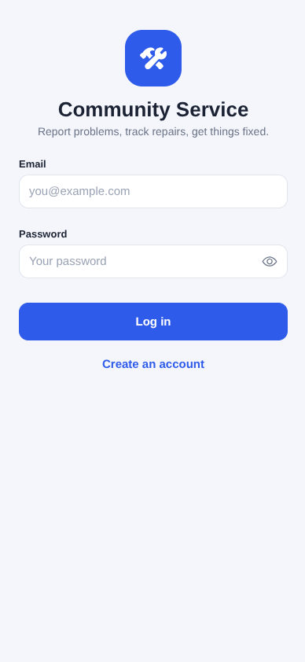

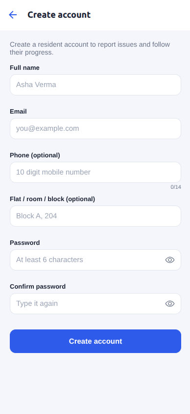

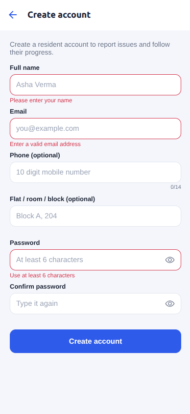

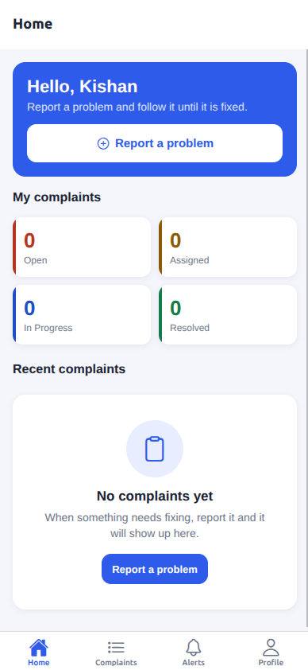

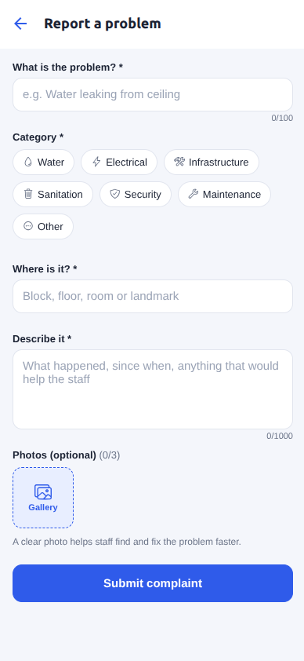

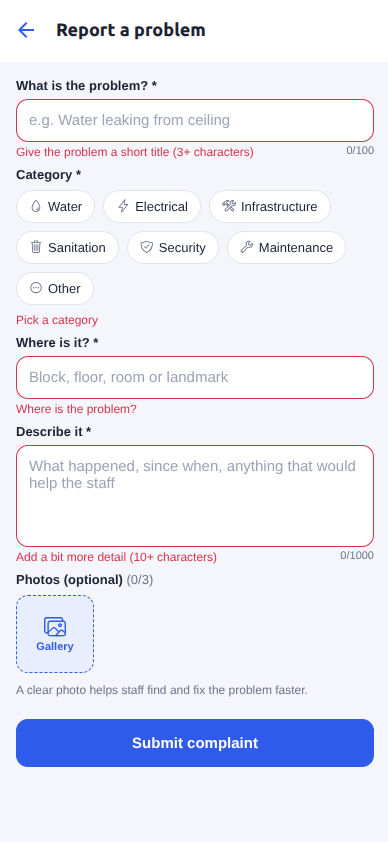

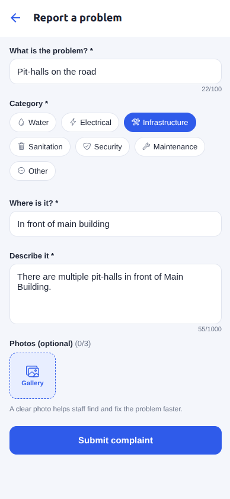

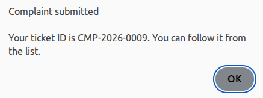

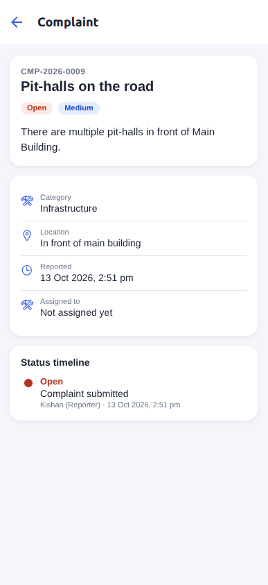

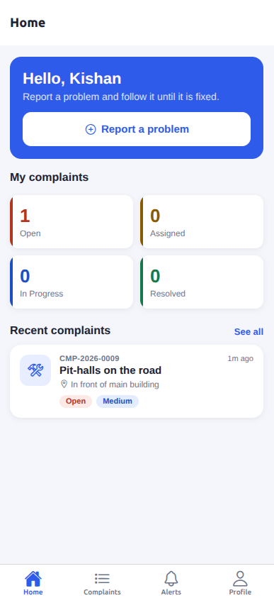

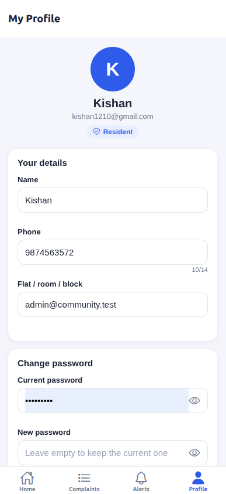

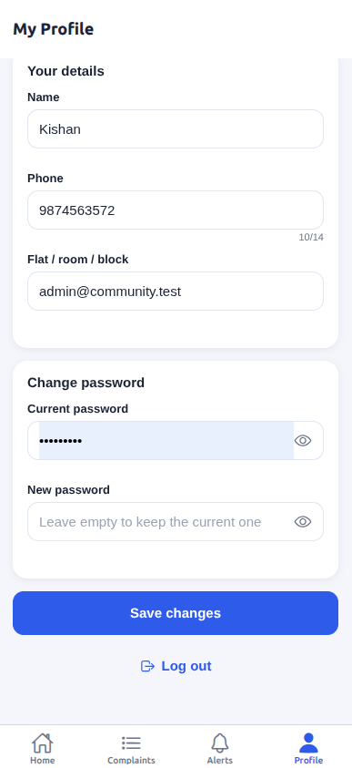

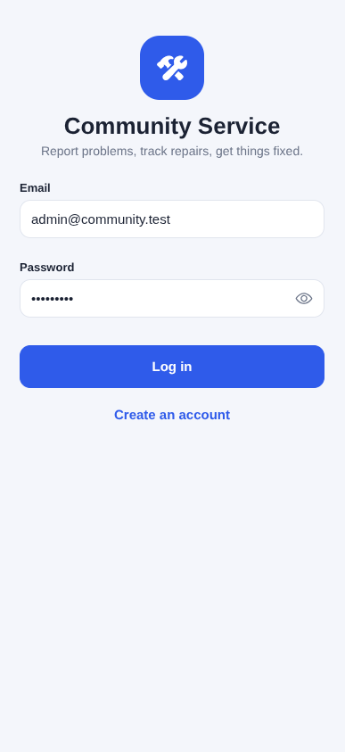

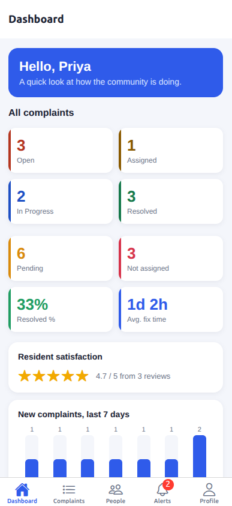

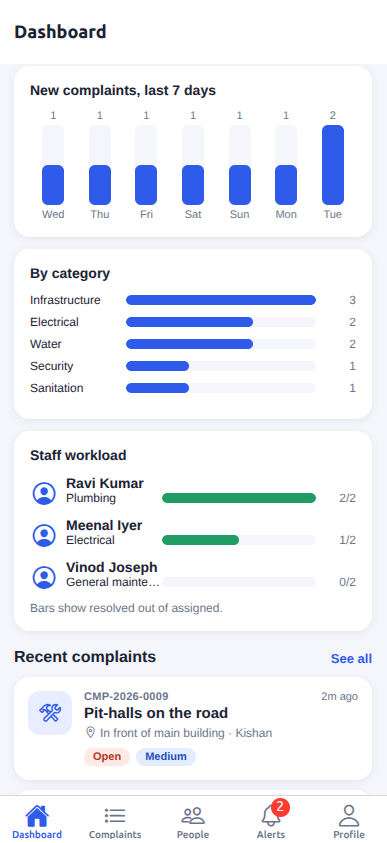

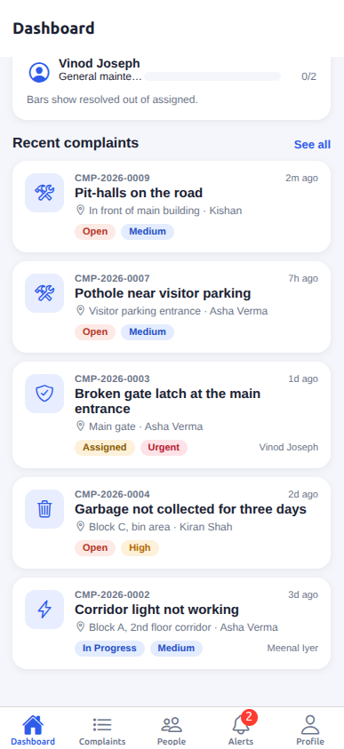

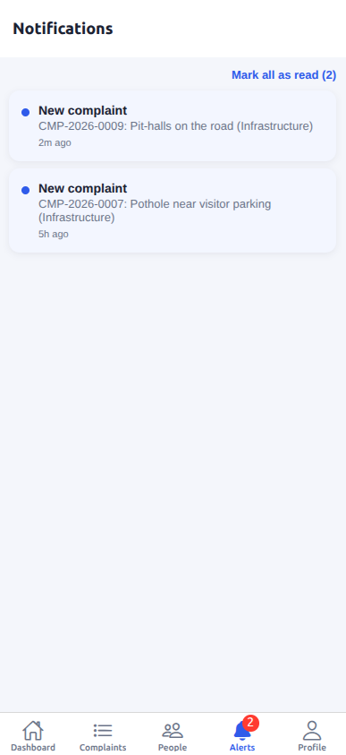

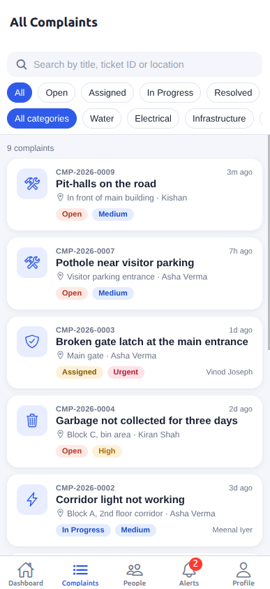

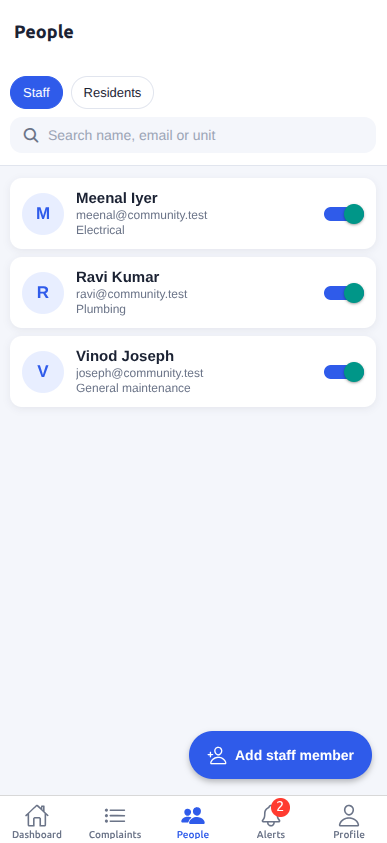

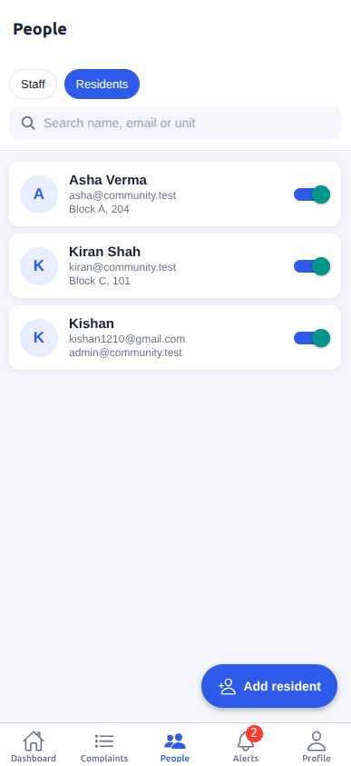

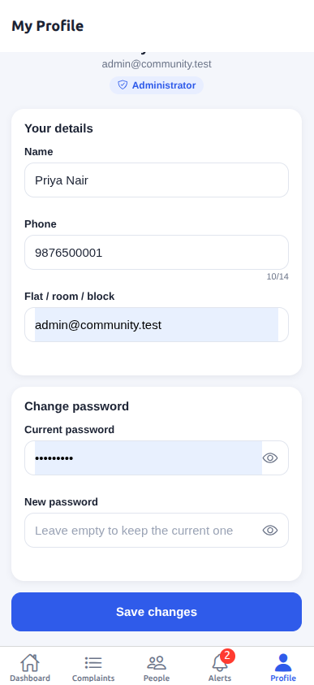

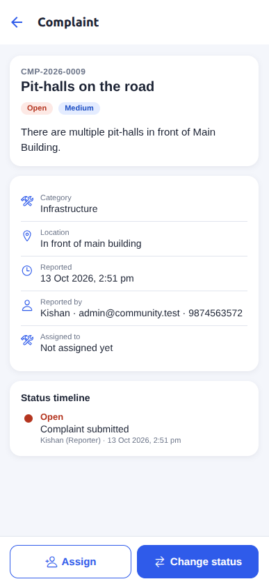

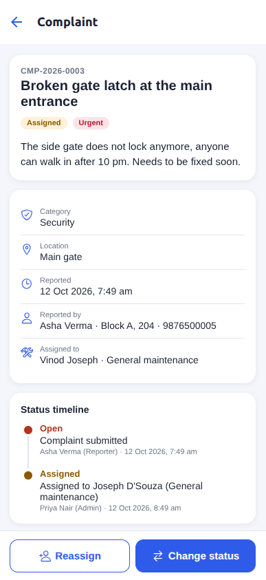


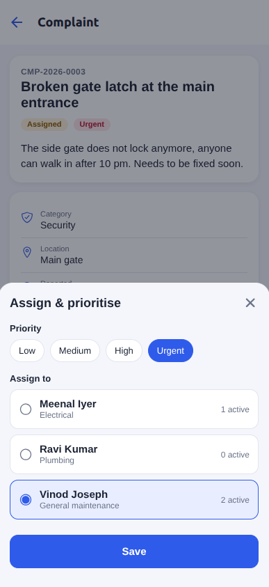

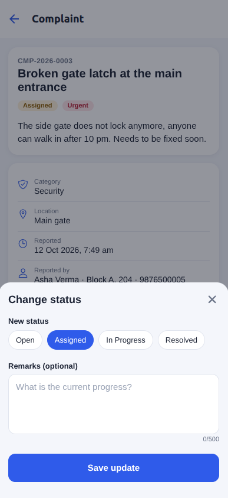

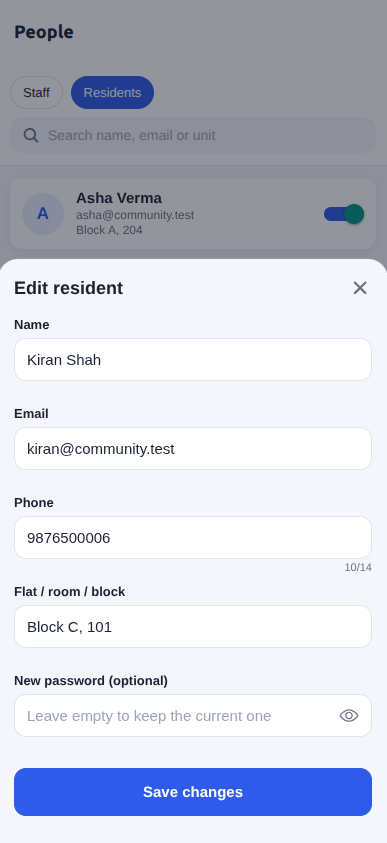

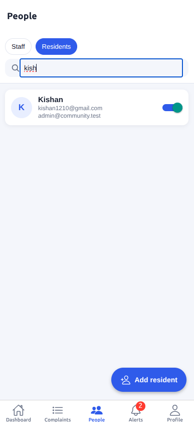

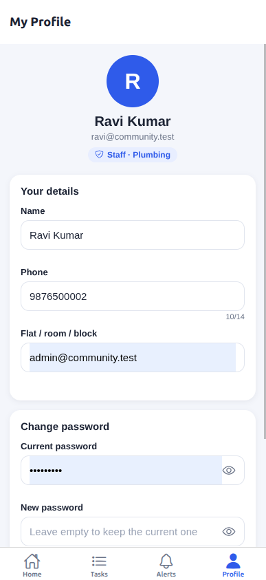

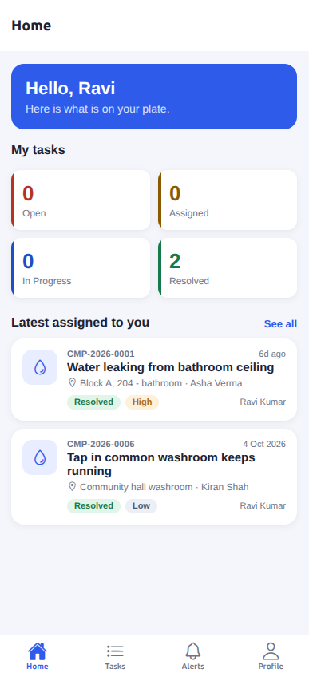

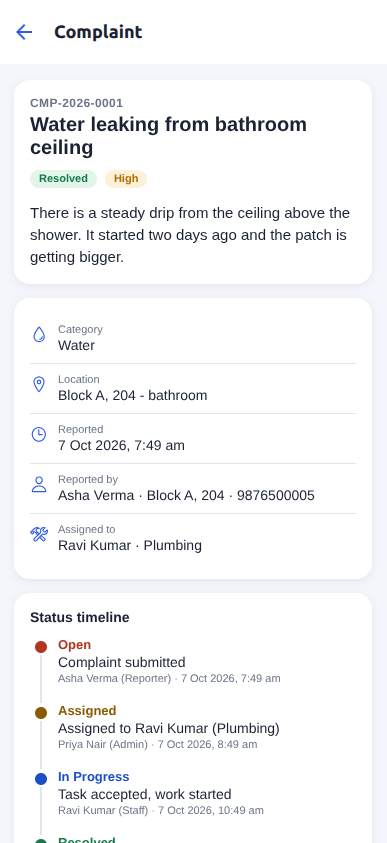

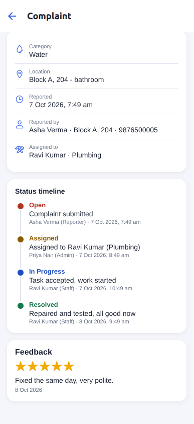

---

Developed by Pankaj Saini

## Things I'd mention if asked

- Validation happens twice: on the form (so people see mistakes right away) and again on the server (so nobody can skip the form).
- People only ever see their own data. The server filters by role on every request, hiding buttons in the app is only cosmetic.
- Anyone can sign up, but only as a resident. Staff and admin accounts are created by an admin (or by the seed script for the first admin).
- Ticket numbers come from an atomic counter in MongoDB, so two people submitting at the same second never get the same ID.
- Photos are limited to JPG/PNG/WEBP/HEIC, 5 MB each.

